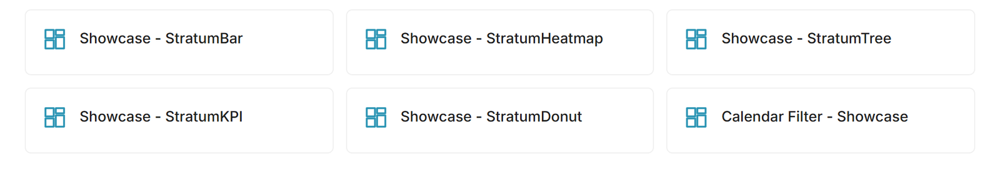

# superset-plugin-chart-navigation-hub

Chart plugin `navigation_hub` for Apache Superset 6.1.0. It turns a dashboard into an index page of tiles, or shows breadcrumbs "Home > current dashboard". It works on its own and pairs with `superset-homepage`.



*List mode: one tile per dashboard, in a screenshot of a real chart in Chrome.*

## Modes

| Mode | Source of the tiles | Permissions |
|:---|:---|:---|
| Tags | Dashboards that have one of the given tags, exact name (`/api/v1/dashboard/` with the `dashboard_tags` filter, paginated). Requires the `TAGGING_SYSTEM` flag | Superset hides dashboards the user cannot access |
| List | Slugs (or ids) in the given order, one call per dashboard | Dashboards that are not accessible or do not exist do not appear |
| Dataset | Rows of the dataset, with columns mapped to title, slug, group, description, icon, order and status | Rows are not filtered by permissions |
| Breadcrumb | Homepage read from `/api/v1/homepage/` (if `superset-homepage` is installed), otherwise the fallback slug | Same as the current dashboard |

Modes without a dataset still need any dataset: the plugin requests a `COUNT(*)`.

## Look

* Grouping by tag or by group column, from 1 to 6 columns.
* Colors and radius come from the Superset theme tokens.
* The Superset 6.1.0 dashboard API does not expose the description. In tag and list modes the text under the title is set with the per-slug override; in dataset mode it comes from the description column.
* Per-slug override in JSON: `{"report-1": {"title": "Report 1", "order": 1, "group": "Group A", "icon": "heart"}, "draft": {"hidden": true}}`.
* Icons: `dashboard`, `chart`, `table`, `heart`, `users`, `calendar`, `map`, `shield`, `flask`, `clock`.
* Tiles are plain links: they open the dashboard in the same tab with a page reload.

## Installation

```powershell
.\install-plugin.ps1 -SupersetPath <superset folder>
```

The script copies the plugin into `superset-frontend/plugins/`, registers `NavigationHubChartPlugin` in `MainPreset.ts` (idempotent, with a backup) and clears the cache. Then rebuild the Superset frontend.

## Development

```powershell
npm install
npm test
npm run build
```

The control panel controls are named `hub_mode`, `hub_tags`, `hub_slugs` and `grid_columns`: `mode`, `tags` and `columns` clash with standard formData keys (`columns` is the list of query columns).
